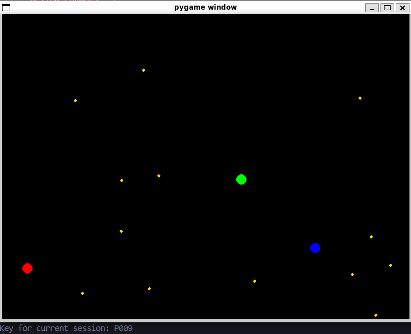

# Multiplayer 2D Low-Level Networked Game

## Project Overview

The project represents a multiplayer 2D low-level network-programmed game. The goal of the game is for 3+ players located on a map, where resources are spawned at certain time intervals, to compete for who reaches a certain number of resources first.

## Network Architecture

The network layer can be implemented using two architectures:

- **Client-Server:** There is a central server that validates and mutates state, while players only submit to the server which actions they perform. On every valid action that changes the game state, the server sends the new state, which the clients render on their side.

- **Peer-to-Peer:** There is no central objective server — i.e. even if a certain client acts as a central server, it is still a player and is biased, meaning it cannot be considered objective. Naturally, this leads to the absence of central-server behavior; instead, every player is connected to every other player. The initial states are known exactly, and every action is computed on the client, but instead of sending a new state to all other clients, the client sends a request for consensus — i.e. given the previous state known to the client, is the new state resulting from the given action valid? Accordingly, the new state is rendered on all clients if it is deemed valid.

## More About the Game

- **3+ players is intentional:** With 2 players, one could initiate a state change and the other could refuse to accept it even if it is valid — i.e. bias again.

- **If one player disconnects, the system keeps running** — there is no central-server behavior. A mechanism will be needed to handle the case where, out of 3 players, one disconnects, so that the scenario above does not occur.

- **Complexity:**
  - The implementation must never need to change for the number of players as long as it is in the range **[3, 30]**.
  - The system must support **reconnection**, synchronizing with the current game state.
  - The **resource spawn interval will not be fixed** — this increases complexity and simulates more realistic usage. **Deterministic seeds** will be used, agreed upon by the clients before the game starts. Resources will be generated **independently on each client**. The seed defines the time intervals and the locations where resources appear. In this way, all clients generate identical resources at the same time and at the same locations, **without the need for a central server** maintaining their state. When a resource is collected, the action is confirmed through the consensus mechanism, after which the resource is removed from the map on all clients.
  - **Anti-cheat:** Validation of actions and consistency checks of the state will be implemented in order to detect invalid and suspicious client behavior.

## Implementation Roadmap

From its earliest stages, the project will implement **Client-Server with queues** in order to demonstrate the idea and allow comparison with the final **P2P** version.

## Client View Shown
